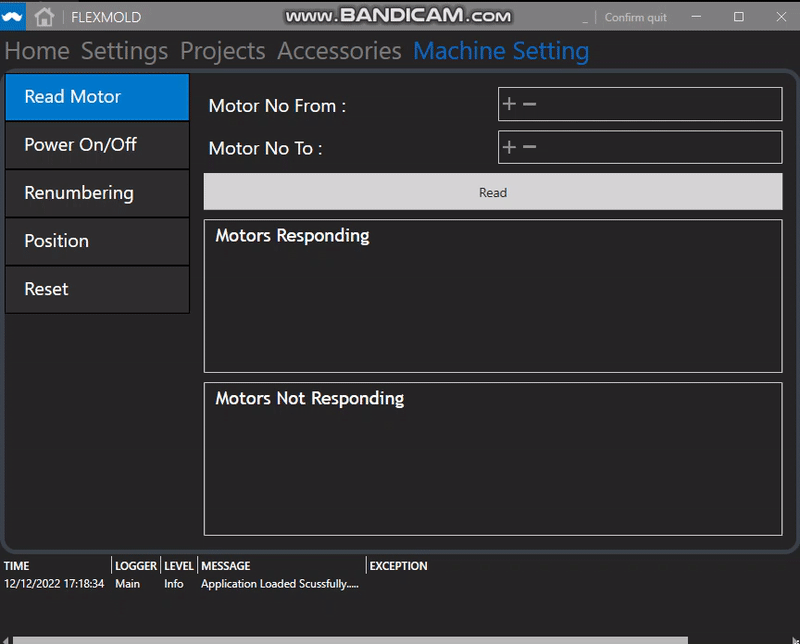

# ChristianRaun-HMIDevelopment
To develop a desktop HMI software for client that runs on Windows 10 or above and is capable to handle / process EtherCAT data
# Title
# Requirements
# Testing
# Issues
[i1]: https://github.com/eSpark-Consultants/flexmold/issues/1
# Results
 
## External Thanks
- [For NLogViewer] https://github.com/erizet/NlogViewer
- [For WPF Panel Control Template] https://www.youtube.com/watch?v=PzP8mw7JUzI&t=1s&ab_channel=Payload
- 

