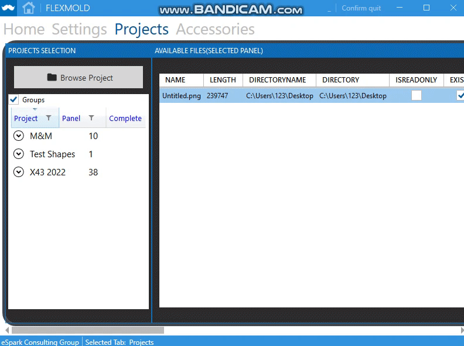

# ChristianRaun-HMIDevelopment
To develop a desktop HMI software for client that runs on Windows 10 or above and is capable to handle / process EtherCAT data
# Title
# Requirements
# Testing
# Issues
[i1]: https://github.com/eSpark-Consultants/flexmold/issues/1
# Results
## Issue #2 Result 05-12-22 Datagrid UI update
 
