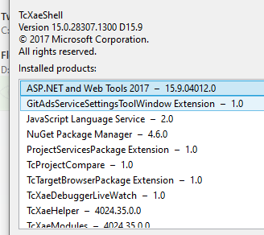

# ChristianRaun-HMIDevelopment
To develop a desktop HMI software for client that runs on Windows 10 or above and is capable to handle / process EtherCAT data
# Introduction
 
# Testing
# Architecture
 
# Installation
Executable can be downloaded from [FCA](./Binaries/FlexMoldV1.0.0.8.rar)
## Prerequisites
- TwincCAT 3.1 
- 
- .Net Runtime 6 (if required)
#### How To Run 
1. Run Application (Flexmold.exe)
2. Select Machine
3. Build TwinCAT Solution and wait
4. Click "Run" button
5. Click on "Machine Setting" tab
 
# Open Issues

# Issue Results
 

## External Thanks
- [For NLogViewer] https://github.com/erizet/NlogViewer
- [For WPF Panel Control Template] https://www.youtube.com/watch?v=PzP8mw7JUzI&t=1s&ab_channel=Payload

