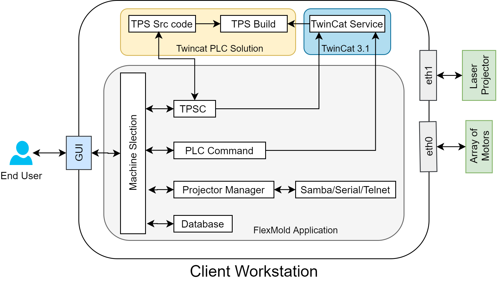
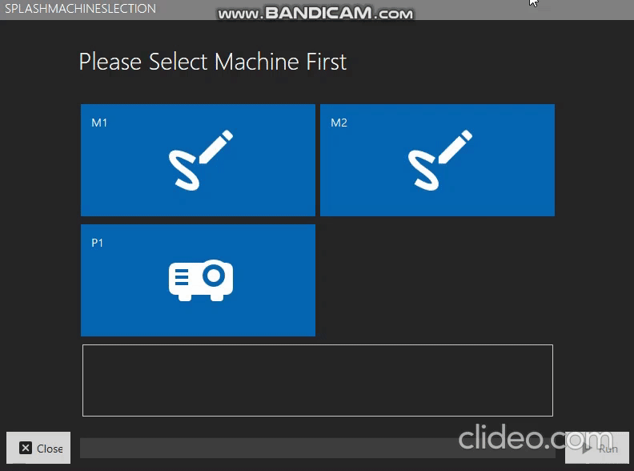
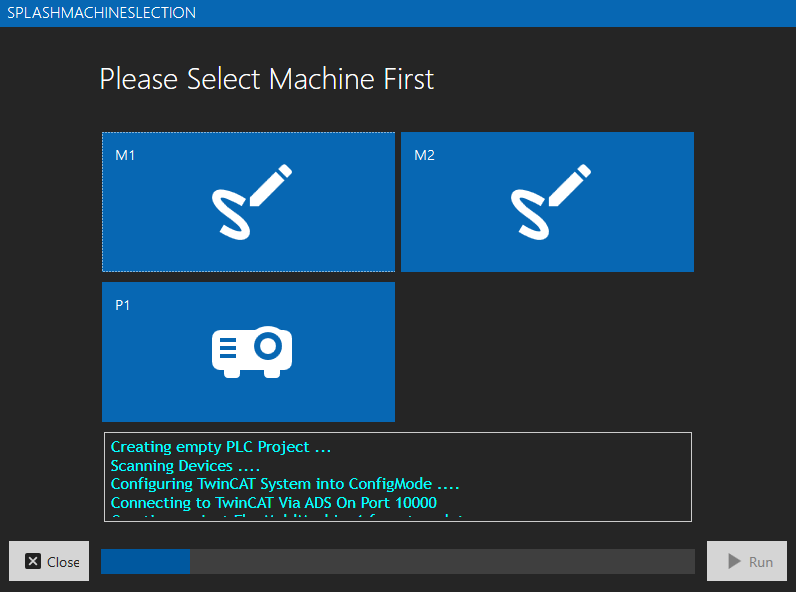

# ChristianRaun-HMIDevelopment
To develop a desktop HMI software for client that runs on Windows 10 or above and is capable to handle / process EtherCAT data
# Introduction
 
# Testing
# Architecture
 
# Requirements
Works with  
```
PROGRAM MAIN 
VAR CONSTANT 
deviceCount : WORD := 2; 
END_VAR 
VAR 
{attribute 'TcLinkTo' := ''}device : ARRAY [1..deviceCount] OF EthercatDevice ; 
counter: WORD; 
END_VAR

FOR counter:=1 TO deviceCount BY 1 DO
device[counter].dummyDataOut:= SHL(device[counter].dir,2*8) OR device[counter].speed ;
END_FOR;
```
# Binaries
Executable can be downloaded from [FCA](./Binaries/FCA%203.rar)
# Issues
[i10]: https://github.com/eSpark-Consultants/flexmold/issues/10
# Results
 
 
 
 
 
## External Thanks
- [For NLogViewer] https://github.com/erizet/NlogViewer
- [For WPF Panel Control Template] https://www.youtube.com/watch?v=PzP8mw7JUzI&t=1s&ab_channel=Payload


